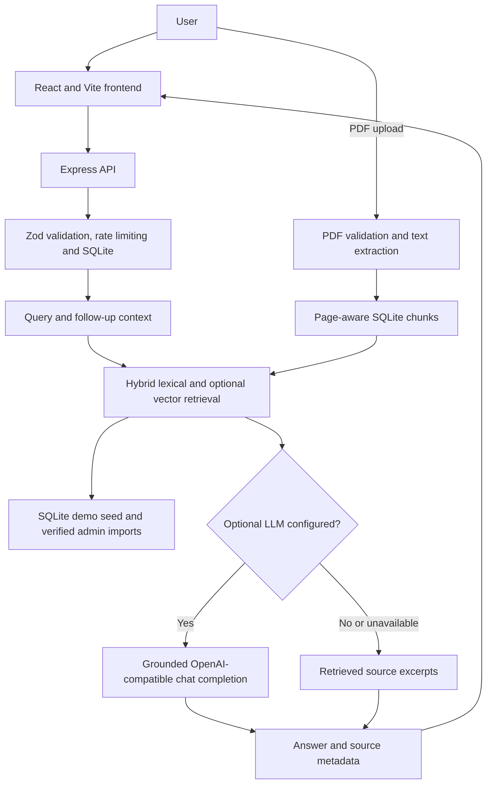

# Manak Mitra

**A source-aware information assistant for Indian Standards and BIS services.** Manak Mitra provides local lexical retrieval, source-linked answers, PDF Q&A, persistent guest conversations, and managed source imports while being explicit about what is and is not verified.

> **Data boundary:** the catalog is a small demo dataset, not a complete/current BIS catalog. It is not an official BIS service and does not determine legal or regulatory obligations. Verify current details on the linked BIS pages.

## Problem and proposed solution

People often need to move between standards catalogs, certification information, and BIS service pages. Manak Mitra brings those discovery paths into one responsive interface: searchable records, concise source-grounded answers, document Q&A, and direct links to official sources.

## Features

- BIS information assistant with conversation follow-up context, retrieval citations, copy, feedback, and language selection.
- Searchable standards and BIS service topic catalogs with prominent sample-data labels.
- Optional OpenAI-compatible chat completion and embeddings providers, configured only on the backend.
- Persistent SQLite vector index with cosine/hybrid lexical retrieval when the optional embeddings endpoint is reachable; lexical retrieval is the fallback.
- PDF upload, file-size/type/signature validation, text extraction, page-aware chunk retrieval, and citations.
- SQLite persistence for guest conversations, session-scoped uploaded document chunks and embeddings, feedback, and administrator source imports with provenance and verification state.
- Knowledge status, operational insights, help, and protected verified-source ingestion views.
- Searchable persisted knowledge inventory with source URLs, record type, demo/verified distinction, and last-updated timestamps.
- Protected administrator review controls to edit, approve, reject, re-index, and delete imported records.
- Protected single-record and JSON batch imports with per-row validation/rejection details; reviewed PDFs can also be imported with provenance.
- Persisted usage analytics for searches, questions, document uploads/chunks, feedback, answer response times, source usage, and API errors with date-filtered activity totals.
- Responsive light theme with keyboard focus styles and reduced-motion support.

## Stack

- Frontend: React 19, TypeScript, Vite, Lucide icons.
- API: Node.js 24+, Express 5, Zod, Helmet, express-rate-limit, Multer, pdfjs-dist, and SQLite.
- Knowledge: checked-in illustrative JSON seeded into SQLite plus optional administrator-reviewed excerpts/PDFs; lexical retrieval includes only demo-labeled or admin-marked-verified material.
- Optional generation: any OpenAI-compatible chat-completions endpoint configured through environment variables.

## Architecture



Without embedding configuration, retrieval uses lexical matching. With a reachable OpenAI-compatible embeddings endpoint, vectors are saved in SQLite and blended with lexical scores. An optional LLM is called only after retrieval returns relevant material; a provider error falls back to retrieved excerpts. No pgvector extension is required.

## Project structure

```text
bis-assistant/
  backend/               Express API, retrieval, prompt, sample data and tests
  backend/evaluation/     Small reproducible retrieval smoke evaluation
  docs/                  Architecture, data, API, security and test notes
  src/                   React application and typed API client
  .env.example           Safe configuration template
```

## Requirements and setup

Use Node.js 22.13 or newer (Node 24.19 was used for verification) and npm. The API uses the built-in `node:sqlite` module.

```powershell
npm install
Copy-Item .env.example .env
npm run dev
```

The development command starts both the Express API at `http://localhost:4174` and Vite at `http://localhost:5173`; Vite proxies `/api` requests to the API. `npm run dev:web` starts only the frontend and `npm run dev:api` starts only the backend. English local retrieval works without an AI key.

## Environment

| Variable | Required | Purpose |
| --- | --- | --- |
| `PORT` | No | API port; defaults to `4174`. |
| `FRONTEND_ORIGIN` | No | Allowed browser origin; defaults to `http://localhost:5173`. Comma-separated origins are accepted. |
| `DATABASE_PATH` | No | SQLite file path; defaults to `backend/data/manak-mitra.sqlite`. |
| `ADMIN_API_KEY` | No | Enables verified-source management routes; keep it server-side only. |
| `AI_BASE_URL` | No | Base URL for an OpenAI-compatible provider, for example a provider's `/v1` endpoint. |
| `AI_API_KEY` | No | Server-side provider credential. Never put it in frontend code. |
| `AI_MODEL` | No | Provider model identifier. |
| `EMBEDDING_BASE_URL` | No | Base URL for an OpenAI-compatible embeddings endpoint (for example, a provider `/v1` endpoint). |
| `EMBEDDING_API_KEY` | No | Server-side embedding provider credential. |
| `EMBEDDING_MODEL` | No | Embedding model identifier; vectors are stored separately per model. |

Generation activates only when all three AI variables are set. No key is included in the repository. With no provider, the assistant returns retrieved excerpts and explicitly notes the source boundary. The UI disables Hindi/Tamil until a provider is configured; local retrieval does not translate.

Semantic retrieval activates when all three embedding variables are set and the configured endpoint passes a live request. The app indexes public demo/verified records on API startup and new eligible records when imported. Private uploaded PDF text is sent to the configured embedding provider when enabled; review the provider's privacy/retention terms before using this with sensitive documents. Status shows configured, connected, unavailable, or indexing required based on an actual provider check and persisted vector count.

## API

| Method | Path | Purpose |
| --- | --- | --- |
| `GET` | `/api/health` | API availability, SQLite health, migration version, and provider configuration. |
| `GET` | `/api/knowledge/status` | Knowledge, database, retrieval, and provider status. |
| `GET` | `/api/knowledge/records?query=&category=&verificationStatus=` | Search/filter the persisted knowledge inventory and inspect provenance. |
| `GET` | `/api/catalog` | Standards and service records from the SQLite-seeded/catalog corpus. |
| `GET` | `/api/standards?query=&category=&page=&pageSize=` | Filtered, paginated local standard records. |
| `POST` | `/api/standards/search` | Hybrid or lexical standards retrieval. |
| `GET` | `/api/standards/:id` | One standard record and source/verification metadata. |
| `GET` | `/api/services?query=&category=&page=&pageSize=` | Filtered, paginated service topics and source links. |
| `POST` | `/api/chat` | Grounded answer, follow-up context, citations. |
| `POST` | `/api/documents/upload` | Validate, extract, chunk, and persist a PDF in SQLite. |
| `GET` | `/api/documents?guestSessionId=...` | List documents scoped to a guest session. |
| `POST` | `/api/documents/query` | Retrieve from one uploaded PDF and cite page. |
| `POST` | `/api/feedback` | Store an anonymous rating in SQLite. |
| `GET` | `/api/insights` | Persisted inventory/provider/activity metrics; date filters use `YYYY-MM-DD` and filter timestamped events, documents, and feedback. |
| `POST` | `/api/admin/knowledge` | Import a reviewed source excerpt with `x-admin-api-key`. |
| `POST` | `/api/admin/knowledge/import` | Validate up to 100 JSON records and report accepted/rejected row numbers. |
| `PATCH` | `/api/admin/knowledge/:id` | Edit an imported record or update its review status with `x-admin-api-key`. |
| `POST` | `/api/admin/knowledge/:id/reindex` | Refresh metadata, ingestion log, and optional model-keyed embedding. |
| `POST` | `/api/admin/knowledge/documents` | Import and index a reviewed PDF with source metadata and `x-admin-api-key`. |

Full request shapes and errors are in [docs/api-documentation.md](docs/api-documentation.md).

## Data and preprocessing

`backend/data/knowledge.json` contains the small base corpus with source title, URL, reference, content, and tags; startup seeds these records into SQLite with `demo` verification status. Three illustrative standard records are based on BIS-published first-licence news items; their scope, edition status, and requirements are intentionally not inferred. No BIS site is crawled or fetched at runtime, and no supported BIS API/feed is configured. Use the official links surfaced in Knowledge Base to review current material, then import only permitted reviewed excerpts or PDFs with source metadata. Imports carry SHA-256 content hashes, timestamps, verification status, and an ingestion log; batch JSON imports return individual rejected row numbers. PDF uploads are text-extracted page by page and split into overlapping chunks. Password-protected PDFs are rejected; scanned-PDF OCR is not implemented. Admin imports remain excluded from retrieval until an administrator explicitly marks them verified; that flag is an administrator assertion, not independent validation. Private user PDFs are stored separately and scoped to their guest-session capability ID.

## Data model and storage

SQLite migrations run automatically at API startup and are in `backend/migrations/`. The health endpoint reports `PRAGMA quick_check` and the applied schema version. Guest conversations, messages, session-owned uploaded PDF chunks, feedback, administrator imports, ingestion logs, semantic vectors, and usage events persist in the configured database file. Guest IDs scope access but are not authenticated identities; the application is not suitable as a public multi-tenant service without authentication and stronger authorization. There is no managed PostgreSQL or external vector database; optional vectors are stored in SQLite. See [docs/database-design.md](docs/database-design.md) for schema and limits.

## RAG and AI

1. Validate the query and select limited follow-up context.
2. Normalize Unicode tokens and rank records by tag/title overlap, requiring all meaningful query terms to match.
3. Abstain when retrieval confidence is below the minimum match threshold.
4. Return source excerpts by default, or send only the retrieved excerpts to the optional provider.
5. Accept model citations only when they reference the retrieved source set; otherwise fall back to retrieved excerpts.
6. Attach source metadata from the retrieved records to the response.

Without configured embedding credentials, this is a lexical RAG implementation. With them, a hybrid retriever combines the lexical score and cosine similarity from vectors persisted in SQLite. Unsupported queries abstain rather than matching generic terms. Citation labels are checked against retrieved source indices; this does not prove that every model claim is entailed by its cited passage. The prompt is in `backend/prompts/system.md`.

## Testing and evaluation

```powershell
npm test
npm run evaluate
npm run build
```

Tests cover ranking, unsupported questions, document retrieval, source labels, Unicode tokenization, embedding provider validation/cosine ranking, and HTTP flows against a temporary SQLite database, including administrator review/update/re-index, PDF ownership and lifecycle, feedback, insights, validation, and rate limiting. The evaluation script writes lexical retrieval results to `backend/evaluation/latest-results.json`; this is a smoke check, not a benchmark of answer correctness, citation entailment, model quality, or real users.

## Deployment

Build with `npm run build`. Deploy the Vite `dist/` frontend as a static site and the Node API separately with `npm start` from the project root. Configure `FRONTEND_ORIGIN`, `DATABASE_PATH`, and optional provider/admin credentials on the API host only. SQLite needs a persistent writable volume. A production deployment needs managed database operations, user authentication, per-user document authorization, monitoring, backups, and abuse controls.

## Limitations and future scope

- No live BIS API/catalog synchronization; sample listings are incomplete and must be verified.
- AI generation and vector retrieval remain unavailable until their respective providers are configured and pass live health checks.
- SQLite is for a local single-instance deployment; guest-session IDs provide capability scoping but not a verified user identity.
- Knowledge import uses a shared admin API key, not role-based authentication. Ingestion status and errors are recorded; there is no remote crawler or independent source-verification service.
- PDF extraction is text-only; scanned pages, tables, and complex layouts may not extract reliably.
- Multilingual generation depends on an externally configured model and has not been evaluated here.
- No verified legal applicability decision, standard reproduction, external URL fetcher, or OCR.

Potential next steps are an authorized BIS dataset refresh pipeline, citation audits against source pages, embedding/reranking evaluation, PostgreSQL/pgvector migrations, OCR with consent, authenticated admin tooling, and reviewed Tamil/Hindi evaluations.

## Team and license

Team contribution details should be completed by the project team before submission. No license has been selected; source data and standards documents retain their respective rights. Do not redistribute BIS standards text without permission.
